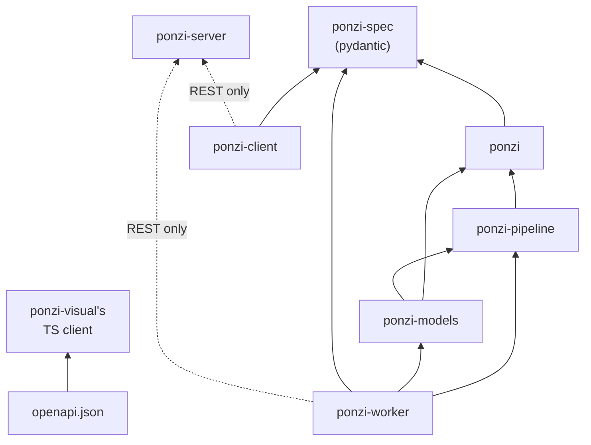

# PONZI overhaul plan

Status: DRAFT for owner sign-off. Nothing in any repository changes until it is signed off.
Date: 2026-10-23, revision 3 (owner, 2026-10-23: download and coherence processing come from `repeat_ccd` and go into ponzi-core as `ponzi-pipeline`; ponzi-models goes into ponzi-core; all Earth Engine functionality is removed; a clean slate, nothing migrated; hosting setup kept out of the repositories).
Baseline: [current-system.md](current-system.md) (ponzi-core v0.2.3 `9134468`, ponzi-models `3b853a7`, repeat_ccd `5250ac4`).

Contents:

1. Target layout: 4 repositories
2. Dependency graph
3. Data spec: the STAC profile
4. Identity, idempotency and the manifest
5. Workflow stages and their interfaces
6. Configuration and path resolution
7. ponzi-service in detail: server, worker, client
8. ponzi-visual
9. ponzi-docs and onboarding of new components
10. Fate of ponzi-models, repeat_ccd, ponzi-apps, ponzi-paper and the monorepo
11. Migration order with a parity check per step
12. Decisions needed from the owner

---

## 1. Target layout

Four repositories. Each distribution is pip installable from git (`pip install "<dist> @ git+<repo>@<tag>#subdirectory=packages/<dir>"`). One pixi workspace per repository stays the development environment; the distributions are what anything else installs.

| Repository | Distributions (import name) | Holds |
| --- | --- | --- |
| `ponzi-core` | `ponzi-spec` (`ponzi_spec`), `ponzi` (`ponzi`), `ponzi-pipeline` (`ponzi_pipeline`), `ponzi-models` (`ponzi_models`) | everything that computes: the shared schemas, the algorithm, data acquisition and coherence processing, training and calibration |
| `ponzi-service` | `ponzi-server` (`ponzi_server`), `ponzi-worker` (`ponzi_worker`), `ponzi-client` (`ponzi_client`) | the REST service, the job runner, the Python client |
| `ponzi-visual` | npm `ponzi-visual` | React + Leaflet front end |
| `ponzi-docs` | none (a site) | MkDocs site for GitHub Pages: guides, API reference, OpenAPI, the STAC profile, agent markdown |

### 1a. ponzi-core: one repository, four distributions

```
ponzi-core/
  pixi.toml                  environments: default, ml, ml-gpu, isce3
                             (conda-forge: isce3, s1reader, compass,
                             dem_stitcher)
  packages/
    spec/      ponzi-spec      pydantic only: STAC profile, manifest, content
                               ids, deployment config, API models, StageSpec
    core/      ponzi           the algorithm, as today minus onboarding and
                               the registry
    pipeline/  ponzi-pipeline  discover, pairs, acquire, dem, coherence,
                               assemble, onboard
    models/    ponzi-models    panels, labels, training, calibration, registry
                               store, standards
  data/
    specs/                   fit specs (versioned data)
    standards/               standard bundles (versioned data)
    run_configs/             run configs (from configs/run/ and the registry
                             entries)
  docs/requests/             one change-request process for all four
                             distributions
  docs/contracts/            C1 .. C26 and the new ones
```

Why separate distributions in one repository and not subpackages of `ponzi`:

- Dependencies differ by orders of magnitude: `ponzi-spec` is pydantic; `ponzi` is numpy, xarray and zarr; `ponzi-pipeline` pulls asf_search, rasterio and, for its ISCE3 backend, conda-forge-only packages; `ponzi-models` pulls torch and wandb.
- The goal asks for models and workflow components to be versionable on their own: each distribution has its own SemVer and CHANGELOG section, and its own tag prefix (`core-v0.3.0`, `pipeline-v0.1.0`, ...).
- One repository keeps one change-request process, one CI (a job per distribution), and the contracts beside every producer and consumer.
- It cannot be `ponzi.pipeline` or `ponzi.models`: `ponzi` is a regular package and two distributions providing `ponzi/` would overwrite each other. The name `ponzi_pipeline` is also the name the monorepo's onboarding used, which the provenance strings in existing sidecars still record (`ponzi_pipeline.onboard`).

### 1b. `ponzi`, stripped

| Keeps | Changes | Leaves |
| --- | --- | --- |
| `contracts`, `core`, `calibration` (the p-value math and the file format), `evaluation`, `grid`, `products`; `validate_store` (moved under `contracts`) | every store writer also emits a STAC Item JSON beside the store (byte-neutral to the store); `forecaster.params.artifact` takes a registry reference (section 4b); `ponzi pvalues` takes a calibration file or a resolver | `onboarding` (sidecar, sample, weather, GHSL) moves to `ponzi_pipeline.onboard`; `models` (the registry) moves to `ponzi_models.registry`, core keeps only an `ArtifactResolver` protocol; `configs/run/` moves to `data/run_configs/`; `tools/run_capped.sh` moves to ponzi-worker |

`validate_store` stays on the consumer side on purpose: C18 makes the coherence engine and PONZI two independent implementations of the same checks, so drift is caught. With the engine now in `ponzi-pipeline`, the engine's own checks live there and PONZI's stay in `ponzi`.

The layering test, the golden files and the CR process stay.

### 1c. `ponzi-pipeline`: from repeat_ccd and from `ponzi.onboarding`

Everything that turns a burst and a date range into the inputs of a run, as functions with typed inputs and outputs. No SLURM and no email: orchestration is the worker's job. No Earth Engine anywhere in the system (owner, 2026-10-23): nothing of repeat_ccd's GEE code is absorbed, and no dependency on `earthengine-api` or the `earthengine` CLI.

```
ponzi_pipeline/
  bursts/       the ESA Sentinel-1 burst id map (repeat_ccd
                scripts/download_burst_catalog.sh, bursts.py), burst
                footprints and grids
  discover/     scene search on ASF and CDSE (repeat_ccd asf.py, cdse.py,
                granules.py)
  pairs/        the pyramid pair list: every acquisition with each baseline of
                baseline_days, with bperp (repeat_ccd baselines.py; new rule,
                below)
  acquire/      SLC and orbit download with auth (repeat_ccd asf.py, cdse.py,
                and the ASF and CDSE parts of auth.py; its GEE and GCS parts
                are not absorbed)
  dem/          DEM per burst footprint (repeat_ccd isce3_coh.prepare_dem,
                dem_stitcher, Copernicus GLO-30)
  coherence/
    isce3.py    the primary backend: topo, coregistration, interferogram,
                multilook, coherence, geocode per burst
                (repeat_ccd isce3_coh.compute_burst_topo, coregister_burst,
                process_burst_pair, geocode_one_burst)
    snap.py     optional backend, extra `snap` (repeat_ccd snap.py), only if
                D4 keeps it
    hyp3.py     optional backend, extra `hyp3` (repeat_ccd hyp3.py), only if
                D4 keeps it
  assemble/     per burst: the pair GeoTIFFs into one coherence store (C1) and
                its engine report (C18). NEW: nothing does this today
  onboard/      the covariates sidecar and pixel sample (from
                ponzi.onboarding, unchanged bytes)
  config.py     CoherenceConfig: the identity of a coherence computation,
                hashed like the run config
```

Two gaps the absorption has to close, because repeat_ccd and PONZI do not meet today:

1. **Pairs.** repeat_ccd builds matched snapshot pairs (a post-event reference and a pre-event reference, each paired with the same secondaries) for GEE snapshot CCD. A PONZI coherence store is a dense pyramid: for every acquisition, the pairs reaching back by each of `baseline_days` (12, 24, 36, 48, 60). `pairs/` gets this rule. The snapshot rule served only the GEE CCD and is not absorbed; the reference selection and baseline computations it uses are.
2. **Store.** repeat_ccd writes one geocoded GeoTIFF per burst and pair and leaves the mosaic to Earth Engine, which is not absorbed. C1 is one Zarr store per burst, `coh (time, y, x, baseline)` float32 on one fixed grid, with `valid_pixels`, `n_finite`, `bperp`, `secondary_date`, platforms and the attrs `baseline_days`, `revisit_days`, `epsg`, `burst_id`, `sensor`, `producer`, `contract_version`. `assemble/` writes it from the pair GeoTIFFs. The grid must be fixed per burst id across all pairs (today each pair's geogrid comes from its bbox, snapped): the grid comes from the burst map footprint snapped to the posting (D9).

`CoherenceConfig` (identity, hashed): backend and its version, polarisation, looks (10x2), coherence window and estimator, the `grid` block (posting, snap rule, CRS rule, footprint buffer; configurable, D9), DEM source and version, baseline_days. Run arguments (not hashed): paths, threads, download source (ASF or CDSE give the same SLC bytes).

### 1d. `ponzi-models`: the former repository as a package

```
ponzi_models/
  panels/        the panel builder (new, section 1e), masks, masked_input,
                 export_pixels, the panel reader
  training/      fit_spec, prepare, train, export, augment, tide, tracking,
                 eval_breakdowns
  calibration/   null_runs, null_rows, build, compare, panel_files
  registry/      the registry store (from ponzi.models, plus STAC Items for
                 models and calibrations)
  standards/     the standard bundles
  cli.py         `ponzi-models <stage> ...`, one subcommand per former script
```

No `sys.path` edits, no `PYTHONPATH`. `hpc/*.sbatch` leave for the worker's cluster profile (section 7b).

**Standard**: the bundle a watched area runs, versioned as one unit. It names the coherence config, the onboarding config, the model (id + artifact digest), the run config, the calibration id(s), the detection recipe, the workflow (section 5) and the minimum distribution versions. Example id `s1-general@1.2.0`.

### 1e. Panels as components (D14: a builder from scratch)

ponzi-apps and ponzi-paper do not exist (owner, 2026-10-23), so the Major-TOM package builder of the monorepo and its C19 layout are not ported. A panel is rebuilt as a component of the system, made and versioned like any other output:

- **A panel spec** (versioned data, `data/panels/<id>-<version>.yaml`) says what the panel is: where its cells come from, how cells are classified and chosen, how they are split, the time window, the coherence config its bursts use, and how pixels are drawn inside a cell. Changing any of it is a new panel version.
- **Panel stages**, each a `StageSpec` with its own Collection, so any of them can be replaced:

| Stage | Reads | Writes | Replaceable part |
| --- | --- | --- | --- |
| `panel-cells` | the panel spec | `ponzi-panel-cells`: the cells (GeoParquet: id, geometry, strata, split) | the cell source (a global grid, a list of polygons) and the cell classifiers (each a small component: a raster or vector layer and a rule) |
| (the S1 workflow, section 5) | the bursts that cover the cells, the panel's window | `ponzi-coherence`, `ponzi-sidecar` per burst | as for any area |
| `panel-masks` (per burst) | the cells, the burst's coherence and sidecar | `ponzi-masks`: layers `cell` (every processed pixel inside the burst's cells), `sample` (the draw), and the draw's stratum and weight per sampled pixel | the draw (strata, quotas, seed) |
| `panel-assemble` | the cells and every burst's masks | `ponzi-panels`: the catalogue (burst, cells, split, window, the Items it uses) and the panel record | none |

- **One reader**, `ponzi_models.panels.Panel`, opened from a `ponzi-panels` Item (or its folder): the bursts of a split in cell order, each burst's coherence store, sidecar and mask store, the sample pixels and their strata, the window, and the panel's identity. Training (`prepare`), the null (`null-runs`, `null-rows`), the pixel export and evaluation read panels only through it. `panel_files.py` and the Major-TOM folder layout go.
- **The sample is a mask layer**, not a separate store: a panel run is `ponzi run` with `--mask-store` and `--mask sample` (or `cell`), the production path (ponzi-core CR-014). Pixel sample stores (C3) remain an optional export for fast training input.
- **Identity**: the panel's content id comes from its spec and the content ids of the coherence, sidecar and mask Items it uses; models and calibrations link to it (`derived_from`), so a manifest traces a model to the cells and scenes it was trained on.
- **Labelled panels** (event panels for evaluation) are the same component with a label layer per burst; label producers are components of their own. Label-free cell panels come first (D17).
- **Defaults** (D18, D19): cells are Major TOM grid cells; each cell is classified by settlement (a built-up layer) and climate (a climate map); pixels are drawn in two strata (built, non-built land) with a fixed quota per cell, the quota shared over the bursts that cover the cell by their processable area inside it, from the spec's seed.

### 1f. Grids: native for processing, Major TOM for outputs (D18)

- **Processing** stays on each burst's native grid: the fixed grid its coherence store was assembled on (D9). Onboarding, runs, p-values and per-burst events are computed there; nothing is resampled except where coregistration needs it (the pairs of a burst share one reference geometry).
- **Outputs** are delivered on the Major TOM grid: a new stage `tile` takes the events of one burst or one path (`detect` / `detect-path`) and writes one Item per Major TOM cell it covers (`ponzi-events-cell`), on the cell's own grid: the cell's UTM zone, at a posting set by the standard. Where bursts overlap inside a cell, the rule is the path mosaic's (`ponzi.grid.mosaic`, a named rule, default `max`). The display raster (`visual` COG) and the events table follow the cell.
- `ponzi.grid` gains the Major TOM grid (cell ids, footprints, the cell's UTM grid) beside its lattice and tile grid; the panel's cells and the outputs use the same definition.

## 2. Dependency graph



Rules, enforced by a layering test in each repository:

- Arrows point one way. `ponzi-models` may import `ponzi-pipeline` (panel builders need sidecars); `ponzi-pipeline` never imports `ponzi-models`.
- `ponzi-client`, `ponzi-server` and `ponzi-visual` never import `ponzi`, `ponzi_pipeline` or `ponzi_models`. The server handles data as STAC Items and opaque assets.
- The three service subpackages share only `ponzi-spec` and the OpenAPI document; they communicate only over REST.
- The worker is the only service component that imports the computing distributions.

## 3. Data spec: the STAC profile

Every artifact that crosses a component boundary is a STAC Item in a known Collection, with its files as Assets. Stores stay Zarr (C1 to C26 do not change); pair coherence stays GeoTIFF (as COG). STAC is the catalog and the lineage around them, not a new file format.

### 3a. Collections

| Collection | Item = | Assets | Contract |
| --- | --- | --- | --- |
| `s1-slc` (external, linked) | one Sentinel-1 SLC scene (ASF/CDSE) | links; local copy in the worker cache | none |
| `s1-orbit` (external, linked) | one orbit file | links | none |
| `ponzi-dem` | one DEM per burst footprint | `dem` (COG) | new |
| `ponzi-pairs` | the pair list of one burst over a span | `pairs` (parquet: dates, baseline, bperp, granules) | new |
| `ponzi-coherence-pair` | one burst, one pair | `coherence` (COG) | new (from repeat_ccd burst TIFs) |
| `ponzi-coherence` | one burst's coherence store over a span | `coh` (zarr), `engine_report` (json) | C1, C18 |
| `ponzi-sidecar` | one burst's covariates sidecar | `covariates` (zarr), `onboard_meta` (json) | C2 |
| `ponzi-masks` | one burst's mask store | `masks` (zarr) | C23 |
| `ponzi-sample` | one burst's pixel sample | `sample` (zarr) | C3 |
| `ponzi-run` | one run of one burst under one run config | `score`, `change`, optional `summary`, `staged`, `pred`, `channels`, `all_channels` (zarr), `run_meta` (json) | C5 to C9, C21, C24, C26 |
| `ponzi-pvalues` | one run coded under one calibration | `pvalues` (zarr) | C22 |
| `ponzi-events` | one burst or one path under one recipe | `events` (zarr), `events_table` (GeoParquet), `visual` (COG) | C25 |
| `ponzi-events-cell` | the events of one Major TOM cell (the delivered output, section 1f) | `events` (zarr on the cell grid), `events_table` (GeoParquet), `visual` (COG), `manifest` | C25 on the cell grid |
| `ponzi-panel-cells` | the cells of one panel version | `cells` (GeoParquet) | new |
| `ponzi-models` | one registered model | `artifact`, `run_config`, `model_card` | registry |
| `ponzi-calibrations` | one calibration | `calibration` (npz) | calibration file |
| `ponzi-panels` | one panel package | `catalogue`, `cells` (parquet) | C19 |
| `ponzi-labels` | one label store | `labels` (zarr) | C11 |
| `ponzi-standards` | one standard version | `standard` (yaml) | new |

Every burst-level Item carries the ESA burst id and footprint; AOIs and watched areas are lists of burst ids.

### 3b. Extensions

Standard STAC extensions wherever they fit: `sat`, `sar`, `proj`, `file` (size and multihash per asset), `processing` (`processing:software` with versions, `processing:lineage`), `version`, `datacube` (Zarr dimensions and variables), `mlm` (for `ponzi-models`), `label` (for `ponzi-labels`).

One PONZI extension (JSON Schema published by ponzi-docs, versioned with `ponzi-spec`):

| Field | Meaning |
| --- | --- |
| `ponzi:content_id` | the content-addressed identity (section 4) |
| `ponzi:stage` | stage name and version that produced the Item |
| `ponzi:config_hash` | the hash of the stage's identity config (run config, coherence config, ...) |
| `ponzi:request` | the non-identity request fields, for the record |
| `ponzi:standard` | the standard id, when produced for a watched area |

Lineage is STAC links: a `derived_from` link per input Item, plus `ponzi:model`, `ponzi:calibration` and `ponzi:standard` links. The provenance graph is these links. The existing zarr attrs stamps (`RunStamp`, the `ponzi_*` attrs) stay unchanged.

## 4. Identity, idempotency and the manifest

### 4a. Content ids

```
content_id = sha256( canonical_json({
    "stage":   {"name": ..., "version": ...},
    "inputs":  [sorted content_ids of input Items; for external Items the granule or file name and checksum],
    "config":  <identity part of the stage config>,
}))[:32]
```

- Computed BEFORE a stage runs. If an Item with that content id exists, the stage is not run and the existing Item is returned. That is the idempotency rule.
- Only identity fields count. Paths, chunks, threads, overwrite and download source do not; the same split ponzi-core makes between run config (C4) and run request (C4a).
- Versions enter through `stage.version`, the stage's own identity version: the stage raises it whenever its output bytes may change for the same inputs and config, so a bit-identical release does not invalidate the cache. It is not derived from a package version, because below 1.0 ponzi-core releases MINOR and PATCH changes alike as `0.y.z+1` (CR-020).
- Granularity follows reuse: a coherence pair is one Item, so a watched area's update computes only its new pairs; the coherence store of the longer span is a new Item assembled from cached pairs (C1 stores are immutable).
- Item ids: `<collection>-<burst or scope>-<content_id[:12]>`.

### 4b. Models referenced by id and digest

Today `forecaster.params.artifact` is a relative path inside the config hash, and `null_runs.py` works around it with a symlink. Target:

```yaml
forecaster: {name: tide, params: {artifact: "registry:tide_s1_mt04@sha256:3f2a...", batch: 4096, device: cpu}}
```

- The hash covers the model's identity (id + digest), not its location. Core resolves the reference through an `ArtifactResolver` (protocol in `ponzi`; folder, object-store and server-backed implementations in `ponzi_models` and the worker).
- This changes every TiDE config hash. On the clean slate (D6) nothing is migrated: the existing registry, its calibrations and their hashes stay where they are, and every model and calibration of the new system is made under the new hash rule. A MAJOR change of `ponzi` (`0.3`) under its own CR (D3).

### 4c. The manifest

One manifest per final output, generated by walking the `derived_from` links back to the external sources. Two renderings of one structure: `manifest.yaml` (human readable, below) and the machine JSON (the Items). Stored as an asset of the final Item and served at `/v1/manifests/{content_id}`.

```yaml
manifest: ponzi-events-t028_058198_iw3-9c1e4d2a7b10
standard: s1-general@1.2.0
created: 2026-11-04T10:12:03Z
chain:
  - stage: discover@ponzi-pipeline 0.1.0
    produced: 41 Sentinel-1 IW SLC scenes, relative orbit 28, 2025-06-01 .. 2026-10-30 (ASF)
  - stage: acquire@ponzi-pipeline 0.1.0
    produced: 41 SLCs, 41 orbit files (checksums in the Items)
  - stage: dem@ponzi-pipeline 0.1.0
    source: Copernicus GLO-30 via dem_stitcher <version>
  - stage: pairs@ponzi-pipeline 0.1.0
    produced: 195 pairs at baselines 12, 24, 36, 48, 60 days
  - stage: coherence@ponzi-pipeline 0.1.0 (isce3 <version>)
    config: {polarisation: VV, looks: 10x2, window: 5x5, posting: <D9>, config hash: ...}
    produced: 195 pair COGs (12 new in this update, 183 reused)
  - stage: assemble@ponzi-pipeline 0.1.0
    produced: ponzi-coherence-t028_058198_iw3-...; engine report: all checks pass; validate-store: pass
  - stage: onboard@ponzi-pipeline 0.1.0
    config: {weather_source: edh, steps: [built, weather, pairdiff, mask, sample]}
  - stage: run@ponzi 0.3.1
    model: tide_s1_mt04 (sha256:3f2a...), run config mon_b5h5_d38pc04_mean (hash ...)
    request: {staged: true, summaries: [et]}
  - stage: pvalues@ponzi 0.3.1
    calibration: mt04-ceiling
  - stage: detect@ponzi 0.3.1
    recipe: default (digest ...)
executed_by: worker ceoas-hina01 (profile ceoas@2026.11), slurm jobs 5812231, 5812240
```

## 5. Workflow stages and their interfaces

A stage is the unit of replacement. Each declares, in `ponzi-spec`:

```python
class StageSpec(BaseModel):
    name: str                      # "coherence"
    version: str                   # from the implementing distribution
    inputs: dict[str, str]         # role -> collection
    params: type[BaseModel]        # identity params (hashed) and request params (not hashed), kept apart
    outputs: dict[str, str]        # role -> collection
    resources: ResourceHint        # cpus, memory, gpu, walltime, environment (default, ml, ml-gpu, isce3)
    fan_out: str | None            # e.g. "per_pair", "per_burst": how the worker splits it into array tasks
```

Implementations register through Python entry points (`ponzi.stages`); a new or replacement stage is a distribution that registers a name, and the worker finds it without code changes.

| Stage | Inputs | Outputs | Implemented by | Today |
| --- | --- | --- | --- | --- |
| `discover` | burst ids, span | `s1-slc` Items (links) | ponzi-pipeline | repeat_ccd asf.py, cdse.py |
| `pairs` | `s1-slc` Items, baseline_days | `ponzi-pairs` | ponzi-pipeline | repeat_ccd baselines.py (snapshot rule); pyramid rule new |
| `acquire` | `s1-slc`, `s1-orbit` | local SLCs and orbits in the cache | ponzi-pipeline | repeat_ccd asf.py, cdse.py, auth.py |
| `dem` | burst footprint | `ponzi-dem` | ponzi-pipeline | repeat_ccd isce3_coh.prepare_dem |
| `coherence` (per pair) | SLCs, orbits, DEM, pair | `ponzi-coherence-pair` | ponzi-pipeline (isce3) | repeat_ccd isce3_coh, rccd-process-isce3 |
| `assemble` (per burst) | pair COGs, `ponzi-pairs` | `ponzi-coherence` (C1 + C18) | ponzi-pipeline | new |
| `validate` | `ponzi-coherence` | report on the Item | ponzi | `ponzi validate-store` |
| `onboard` | `ponzi-coherence` | `ponzi-sidecar`, `ponzi-sample` | ponzi-pipeline | `ponzi onboard` |
| `run` | coherence, sidecar, model, run config, optional masks | `ponzi-run` | ponzi | `ponzi run` |
| `pvalues` | `ponzi-run`, calibration | `ponzi-pvalues` | ponzi | `ponzi pvalues` |
| `detect` / `detect-path` | `ponzi-pvalues`, `ponzi-run` (summary) | `ponzi-events` | ponzi | `ponzi detect`, `detect-path` |
| `tile` | `ponzi-events` | `ponzi-events-cell`, one per Major TOM cell (section 1f) | ponzi | new |
| `publish` | `ponzi-events` + manifest | uploaded final Item | worker | none |
| model stages: `masks`, `export-pixels`, `prepare`, `train`, `export`, `null-runs`, `null-rows`, `calibrate`, `register` | as in current-system.md 2a | `ponzi-masks`, `ponzi-models`, `ponzi-calibrations` | ponzi-models | ponzi-models scripts |

A workflow is an ordered list of stage references with versions, as data (`workflow: s1-monitoring@1.0.0`), named by the standard. The worker expands a request into stage jobs and skips any whose content id already exists.

## 6. Configuration and path resolution

One deployment config per installation, the same schema for every distribution (in `ponzi-spec`):

```yaml
# ponzi.yaml
roots:                     # URIs through fsspec: file://, s3://, gs://
  data: file:///storage/ceoas-scratch/barthelp/ponzi/data
  cache: file:///storage/ceoas-scratch/barthelp/ponzi/cache
  registry: file:///storage/ceoas-scratch/barthelp/ponzi/data/registry
  scratch: file:///storage/ceoas-scratch/barthelp/ponzi/data/tmp
server: {url: https://ponzi.example.org, key_env: PONZI_WORKER_KEY}
credentials: {file: ~/.config/ponzi/credentials.env}   # Earthdata, CDSE, CDS, wandb; never inline
cluster_profile: ceoas@2026.11                          # worker only
```

- Lookup: `--config`, then `$PONZI_CONFIG`, then `./ponzi.yaml`, then the user config dir (platformdirs), then built-in defaults.
- Precedence of values: flags > environment (`PONZI_ROOTS__DATA`, ...) > config file > defaults; the rule ponzi-core's CommandArgs already uses. `PONZI_DATA_ROOT` and `PONZI_MODEL_REGISTRY` stay as aliases.
- Credentials: repeat_ccd's order (explicit argument, then environment, then a `.env` file) is kept, but the `.env` is named by the config instead of found at a repository root.
- Code holds no hostnames, cluster paths or user names. Every path in code is a `pathlib.Path` or a URI resolved through one `ponzi_spec.paths` helper. A test in each repository greps for absolute paths and `os.path` (repeat_ccd uses `os.path` and `os.system`; both go during absorption).

## 7. ponzi-service

### 7a. ponzi-server

FastAPI, SQLAlchemy (SQLite on a standalone machine, Postgres in the cloud), storage through fsspec. It never imports the computing distributions and never calls out to a worker.

API `/v1` (OpenAPI generated from `ponzi-spec` models, published by ponzi-docs):

| Resource | Methods | Purpose |
| --- | --- | --- |
| `/bursts` | GET (bbox, track) | the burst catalog for selection (the ESA burst id map, loaded from `ponzi_pipeline.bursts` at deploy time) |
| `/standards`, `/models`, `/calibrations` | GET | what can be run |
| `/areas` | GET, POST, PATCH, DELETE | watched areas: burst ids, standard, cadence, active flag |
| `/requests` | GET, POST | one-off runs: bursts, dates, standard; returns existing Items when the content ids exist |
| `/jobs/claim` | POST (worker key, capabilities) | lease the next job the worker can run; returns job + lease id + expiry |
| `/jobs/{id}/heartbeat` | POST | extend the lease; report progress |
| `/jobs/{id}/complete`, `/fail` | POST | final Items or the error; a failed job returns to the queue up to a retry limit |
| `/uploads` | POST | presigned URL (cloud) or chunked upload (disk) for final assets |
| `/stac/collections`, `/stac/search`, `/stac/collections/{c}/items/{id}` | GET | a STAC API subset |
| `/manifests/{content_id}` | GET | the manifest (yaml or json) |

Jobs and leases: a claim is atomic; a lease expires unless heartbeated (default 10 minutes; for SLURM-backed jobs the worker's poll loop heartbeats, not the compute node); an expired lease returns the job to the queue; completing an already completed content id is a no-op. A crashed SLURM job is retried and never duplicated.

Watched areas: an internal scheduler creates a `discover` job per active area at its cadence (default daily). A worker runs it and posts new acquisitions; the server expands them into the rest of the workflow, ending in a staged monitoring run (ponzi-core CR-021: a new run per update, never appended). The server only creates jobs; it pushes nothing to anyone.

Auth: scoped keys (`worker`, `client:read`, `client:write`, `admin`), hashed in the database, sent as bearer tokens.

### 7b. ponzi-worker

```
ponzi_worker/
  loop.py        claim -> plan -> execute -> heartbeat -> publish
  plan.py        expand a job into stage jobs; skip existing content ids; fan
                 out per pair or per burst
  executors/     local.py (subprocess or in-process), slurm.py (sbatch arrays,
                 squeue/sacct polling)
  profiles/      cluster profiles (versioned data)
  cache.py       content-addressed cache with retention and NFS-safe locking
  stages/        thin adapters over ponzi, ponzi_pipeline and ponzi_models
  approve.py     the approval gate
```

- Runs as a container in the cloud, on a SLURM login node, or on a standalone machine. One loop; the executor differs.
- The SLURM orchestration repeat_ccd does itself (array jobs with a throttle, a compute-node orchestrator, sacct polling, bulk-ingest fallback, NFS `mkdir` locks for shared downloads, retry on stale NFS handles and corrupt zips) moves here, so `ponzi-pipeline` keeps only the per-pair and per-burst functions.
- **Cluster profile**: the SLURM layout of today, from ponzi-models' job files and repeat_ccd's run scripts, as versioned data, `profiles/ceoas.yaml`:

```yaml
profile: ceoas
version: 2026.11
login: shell-hpc                      # shell.hpc.oregonstate.edu
roots: {data: /storage/ceoas-scratch/barthelp/ponzi/data, lab: /ceoas/Vandenhoek_Lab/home/barthelp}
partitions:
  gpu:   {name: ceoas-gpu, nodes: [ayaya01, ayaya05], gres: "gpu:1", note: "GTX 1080 Ti, SM 6.1: torch 2.6 / CUDA 12.4 only; cuDNN off"}
  cpu:   {nodelist: hina01, note: "other nodes read scratch slowly"}
  bulk:  {name: ceoas, account: ceoas, note: "coherence arrays; 250G nodes: 48G per task fits 5, 64G fits 3"}
environments:                         # pixi environments of a tagged ponzi-core release
  default: "{lab}/ponzi-core-releases/{core_version}/.pixi/envs/default/bin/python"
  ml:      "{lab}/ponzi-core-releases/{core_version}/.pixi/envs/ml/bin/python"
  ml-gpu:  "{lab}/ponzi-core-releases/{core_version}/.pixi/envs/ml-gpu/bin/python"
  isce3:   "{lab}/ponzi-core-releases/{core_version}/.pixi/envs/isce3/bin/python"
redirect_under_data: [TMPDIR, WANDB_DIR, TORCH_HOME, XDG_CACHE_HOME]
logs: "{data}/logs"
stage_resources:                      # from hpc/*.sbatch and repeat_ccd defaults
  coherence: {partition: bulk, cpus: 8, mem: 48G, time: "04:00:00", array_throttle: 100}
  acquire:   {partition: cpu, cpus: 8, parallel_downloads: 8}
  train:     {partition: gpu, cpus: 8, mem: 32G, time: "08:00:00"}
  prepare:   {partition: cpu, cpus: 4, mem: 32G, time: "04:00:00"}
  null-runs: {partition: cpu, fan_out: per_burst}
  eval-breakdowns: {partition: cpu, cpus: 4, mem: 32G, time: "02:00:00"}
approval: required
```

  Scripts are rendered from one template per executor with the profile's values; the current `hpc/*.sbatch` and repeat_ccd's generated array scripts are the reference the rendered scripts are checked against (phase 7).
- **Approval gate**: with `approval: required` the worker renders the job scripts and stops at `awaiting_approval` (visible through the server). Nothing is submitted, rsynced or otherwise sent to the cluster until the owner runs `ponzi-worker approve <job>`, which shows job count, runtime and resources first. `--dry-run` prints the scripts and resources and exits.
- **Cache**: `cache://<collection>/<content_id>/`, plus SLCs and orbits by granule name. Intermediate Items (SLCs, DEM, pair COGs, coherence stores, sidecars, runs, p-values) live only here; final outputs (`ponzi-events` with its `visual` COG, the `ponzi-pvalues` Item, the manifest) are uploaded. Retention in the deployment config: keep pair COGs and the latest coherence store, sidecar and run per burst and standard of active watched areas; evict SLCs once every pair that needs them exists (repeat_ccd's `--cleanup`); evict anything else older than N days (default 30) or past a size cap, least recently used first; never evict what a running job reads. Eviction is safe because content ids make every Item reproducible.
- Environments: on SLURM the profile's pixi environments of a tagged release; in the cloud one image per release with the four ponzi-core distributions and the `isce3` conda environment.

### 7c. ponzi-client

- Python: `ponzi_client.Client(url, key)`, typed with `ponzi-spec` models: areas, requests, STAC search, manifests, asset download (fsspec from the shared storage when configured, else through the server). A CLI `ponzi-client ...` over the same calls; the only interface agents use.
- TypeScript: in ponzi-visual (`src/client`), its only user, its types generated from ponzi-server's committed `openapi.json`; not a package of ponzi-service and not published (owner, 2026-10-26: one client subpackage in ponzi-service). D2.
- Both are regenerated and contract-tested on every API change.

## 8. ponzi-visual

- React + TypeScript, Vite, react-leaflet, OpenStreetMap basemaps; all data through its own TS client (`src/client`), generated from ponzi-server's `openapi.json`.
- Views: a burst map (footprints from `/bursts`, select by click or box), the watched-area list (add, pause, remove), per area the latest events (the `visual` COG and the events table), the manifest of any layer, the job status of an area.
- If D5 keeps it, the download portal of repeat_ccd (`downloads/`, Netlify functions, per-conflict GeoJSON packages) becomes a view here, fed from `ponzi-events` Items in the server's storage (no Earth Engine).
- Its own CI (lint, typecheck, unit tests against a mock server from the OpenAPI document).

## 9. ponzi-docs and onboarding of new components

MkDocs Material on GitHub Pages; mkdocstrings for the Python API of every distribution (built from tagged versions); the OpenAPI document rendered; the STAC profile and the PONZI extension schema at stable URLs.

```
docs/
  index.md                       what PONZI is, the 4 repositories and their
                                 distributions, how they talk
  concepts/                      runs, coherence, calibration, standards, STAC
                                 profile, content ids, manifests
  guides/                        install, deploy a server, run a worker
                                 (local, slurm, cloud), use the client
  reference/                     API per distribution, REST (OpenAPI),
                                 contracts C1..C26 and new, STAC collections
  methods/                       coherence estimation (repeat_ccd
                                 docs/coherence_estimation_methods.md: why
                                 radar geometry, the backends compared)
  contributing/
    process.md                   change requests, SemVer per distribution, the
                                 compatibility matrix
    new-stage.md                 onboarding a new processing component (e.g. a
                                 coherence backend)
    new-model.md                 onboarding a new model
  agents/
    llms.txt                     index for agents
    usage.md                     using the system: ponzi-client only, with
                                 recipes
    contributing.md              the agent version of contributing/, as
                                 checklists
  history/                       what moved from where; the decision log;
                                 repeat_ccd's backend experiments
```

**Onboarding a new component** (the same checklist in `contributing/` for people and `agents/contributing.md` for agents):

1. Write a change request: what it consumes and produces (collections), its identity params, its resources.
2. Implement `StageSpec` in a distribution; register the entry point `ponzi.stages`.
3. Add the output Collection (or reuse one) to the STAC profile in `ponzi-spec`, with its schema test.
4. Provide synthetic fixtures and a contract test (inputs → outputs validate, content id stable).
5. For a coherence backend: equality or a documented tolerance against the primary backend on a reference burst, and the C18 checks pass on its assembled store.
6. For a model: fit spec, training, registration as a `ponzi-models` Item with `mlm`, a calibration, then a new standard version; a model joins a standard only after the benchmark (as now).
7. A docs page and its agent checklist; a compatibility matrix row.

READMEs keep only what the repository is and how to start; details move into ponzi-docs. Docstrings: one short line per function, more only where behaviour is not obvious.

## 10. Fate of the other repositories

### 10a. ponzi-models → `ponzi-core/packages/models`

Copied into the subdirectory as uncommitted files, without its git history (owner, 2026-10-23), scripts turned into modules, `specs/` into `data/specs/`, `hpc/` into the worker profile. The repository is archived read-only with a pointer.

### 10b. repeat_ccd → `ponzi-core/packages/pipeline` (download and processing only)

repeat_ccd is a separate project (author Corey Scher). Absorption copies the needed code into `ponzi-core/packages/pipeline` with a note of its origin (D10); repeat_ccd itself is not changed or archived by this plan.

| repeat_ccd | Goes to |
| --- | --- |
| `asf.py`, `cdse.py`, `granules.py`, `auth.py` | `ponzi_pipeline.discover`, `acquire` |
| `bursts.py`, `scripts/download_burst_catalog.sh`, `list_bursts.sh` | `ponzi_pipeline.bursts` |
| `baselines.py` | `ponzi_pipeline.pairs` (plus the new pyramid rule) |
| `isce3_coh.py` (`prepare_dem`, `compute_burst_topo`, `coregister_burst`, `process_burst_pair`, `geocode_one_burst`, `_compute_coherence`), `coherence.py` | `ponzi_pipeline.dem`, `coherence.isce3`; its GEE functions (`ingest_isce3_pair`, `short_asset_name`, the GEE mosaic path of `merge_burst_tifs`) are removed |
| `cli/process_isce3.py`, `tasks.py`, the SLURM parts of `cli/process_local.py` | ponzi-worker (executors, fan-out, locking, retries) |
| `snap.py`, `hyp3.py`, `cli/watch.py`, `submit_jobs.py` | optional backends if D4 keeps them, without their GEE ingest; else not absorbed |
| `isce2.py`, `snap_bud.py`, `cslc.py`, `burst_pipeline.py`, `cli/process_cslc.py`, `run_bud.py` | not absorbed (superseded or abandoned; recorded in ponzi-docs history) |
| `ccd.py`, `beta_ccd.py`, `cli/run_ccd.py`, `gee_stats.py`, `export_mean_std.py`, `gov_coherence_ts.py`, `regions.py` (GEE snapshot and time-series CCD) | removed: Earth Engine |
| `ingest.py`, `cli/download_upload.py`, `scripts/cleanup_gee_collections.py`, `delete_gee_assets.sh`, `gee_damage_preview.js`, `ingest_*.py` | removed: Earth Engine |
| `damage_postprocess.py`, `cli/postprocess.py`, `export_downloads.py`, `downloads/` portal | D5 (they read GEE outputs today; only the portal's page design could carry over to ponzi-visual) |
| `notify.py` | D5: server notifications |
| `boundaries/*.geojson`, `runs/*.sh` | watched areas and requests on the server |
| `.claude/commands/` (hpc-nodes, hpc-status, run-country, ...) | ponzi-docs agent pages and the worker profile |
| `docs/*.md` | ponzi-docs `methods/` and `reference/` |
| `scripts/` diagnostics (`check_*`, `diagnose_*`, `test_*`, `fix_*`) | not absorbed; the checks that guard correctness (grid alignment, burst geolocation, deburst, valid mask) become tests of `ponzi_pipeline` |

### 10c. ponzi-apps, ponzi-paper, the monorepo

ponzi-apps and ponzi-paper do not exist (owner, 2026-10-23, D14); nothing is ported from them. What ponzi-core and ponzi-models said they held is rebuilt where the new system needs it:

| Role | Rebuilt as |
| --- | --- |
| AOIs, campaigns, onboarding configs | server watched areas and requests; onboarding configs in standards |
| panel builders (Major-TOM, BRIGHT packages, C19) | panels as components (section 1e) |
| label producers (C11) | label components (D17) |
| the run-config generator (`experiments.yaml`) | not rebuilt: run configs are written per standard in `data/run_configs/` |
| pages and maps | ponzi-visual |
| HPC jobs and rules | the worker's cluster profile (section 7b) |
| campaign planning, AOI registry, validation tables (C13 to C17, monorepo) | server areas and requests, STAC search |
| the S1 coherence engine of the archive stores | not used: clean slate on `ponzi_pipeline` (D6) |

The contracts that described those pieces (C13 to C17, C19) are retired with a note; C11 stays for the label components.

## 11. Migration order

Each phase ends with its parity check green and a CHANGELOG entry. Code changes stay uncommitted in the working trees; the owner reviews, commits, tags and pushes (D10). No old path is removed before its replacement passes parity.

| # | Phase | Work | Parity check |
| --- | --- | --- | --- |
| 0 | Port reference (**approved 2026-10-23 (D16); the kit is ready**, ponzi-core CR-036, `packages/pipeline/reference/phase0`; to be submitted by the owner from the HPC login node) | With approval: `rccd-process-isce3` on a handful of pairs of one burst, the burst GeoTIFFs and the software versions recorded, as the reference the ported ISCE3 code is checked against. No reference of today's PONZI data chain is needed: the system starts on a clean slate (D6), and the code moves are held by the synthetic tests and golden files | the port reference exists and reruns identically |
| 1 | `ponzi-spec` (**done 2026-10-23**, uncommitted: CR-024, 38 tests; ponzi-docs skeleton builds with `--strict`) | STAC profile, PONZI extension, content id, manifest, deployment config, StageSpec, API models. ponzi-docs skeleton (builds locally; hosting per D15) | schema tests; example Items validate with stac-validator |
| 2 | ponzi-core restructured (**done 2026-10-23**, uncommitted: CR-025 layout, CR-026 registry references, CR-027 `ponzi.stac`; 580 fast and 39 `ml` tests pass, the golden files untouched. No new hash rule was needed: a reference hashes as itself and paths keep their hashes, so `ponzi` stays `0.2.z`. Moving `validate_store` under contracts is left to phase 4, with the onboarding move) | `packages/spec`, `packages/core`; STAC Item emission; `ArtifactResolver`; `validate_store` under contracts; config hash v2 (own CR, `ponzi` 0.3) | every golden file of the arrays unchanged; the hash goldens change on purpose, and only they |
| 3 | ponzi-models absorbed (**done 2026-10-23**, uncommitted: CR-028; `ponzi-models` 0.1.0 with 91 tests passing and 18 skipped, 109 passing in `ml`. The registry left `ponzi`, and `ponzi` finds the registry's resolver through an entry point. The panel builders and labels of ponzi-paper wait for D14) | history merged into `packages/models`; modules and CLI; pathlib; deployment config; registry from `ponzi.models`; standards; ponzi-paper builders and labels | the former tests pass unchanged, incl. training window = inference window and the calibration stages on the synthetic panels |
| 4 | ponzi-pipeline, onboarding (**done 2026-10-23**, uncommitted: CR-029; `validate_store` moved to `ponzi.contracts.validate`; core 514 tests and pipeline 61, together the 575 of before) | `ponzi.onboarding` → `ponzi_pipeline.onboard` | sidecars and samples on the bytes of before (the onboarding tests) |
| 5 | ponzi-pipeline, acquisition and coherence (**done 2026-10-23 except the port reference**, uncommitted: CR-032; every module tested without network or ISCE3, the estimator byte-equal to repeat_ccd's, the assembled store passes `validate-store` with the engine report agreeing, the ISCE3 API checked in the `isce3` env. Open: the byte check against `rccd-process-isce3` needs the phase 0 HPC job (D16); the CDSE route is a follow-up) | `discover`, `acquire`, `dem`, `pairs` (pyramid rule), `coherence.isce3`, `assemble`, the `isce3` pixi environment | per-pair COGs equal the port reference on the bytes with the same isce3 version; the assembled store passes `validate-store` and its own C18 report agrees |
| 6 | worker, local executor (**done 2026-10-23**, uncommitted: `ponzi-worker` 0.1.0 in ponzi-service, ponzi-core CR-033; 20 worker tests on the laptop. Stages so far: ingest-coherence, ingest-calibration, onboard, run, pvalues, detect, tile. The pipeline stages before assembly and the model stages come with phases 8 and 8b; the server loop with phase 7) | stages, cache, manifests, `--dry-run` | on a synthetic burst the worker's chain equals the stages called directly, on the bytes; a second submission runs nothing |
| 7 | server + Python client (**done 2026-10-23**, uncommitted: `ponzi-server` 0.1.0, `ponzi-client` 0.1.0, `ponzi-worker` serve loop, ponzi-core CR-034; 49 ponzi-service tests in-process, plus a localhost smoke run. The contract tests run the worker and the client against the real app in-process, not a mock. Not yet: the area scheduler (phase 9), presigned object-storage uploads) | API, jobs and leases, uploads, STAC subset, keys; OpenAPI | contract tests worker ↔ mock server and client ↔ server; lease expiry requeues; duplicate completion is a no-op |
| 8 | worker, SLURM executor (**done 2026-10-23 on the laptop**, uncommitted: the `ceoas@2026.11` profile corrected to the reference files, `executors/slurm.py`, `node.py`, `approve`, ponzi-core CR-035; the 12 reference scripts in `tests/data/reference`; nothing submitted. Open: the release environments `ml`, `ml-gpu`, `isce3` of ponzi-service, and one approved HPC job reproducing the port reference, D16) | ceoas profile, templates, approval gate | rendered scripts match today's `hpc/*.sbatch` and repeat_ccd's array scripts in resources, environment and paths; one approved job reproduces the port reference |
| 5b | panels and the Major TOM grid (**done 2026-10-23**, uncommitted: CR-030 grid and `tile`, CR-031 panels; the grid equals the reference on 412 golden points; every suite green: core 524, pipeline 61, models 93 and 111 in `ml`. Not yet: the burst lookup for cells, which needs the burst map of phase 5, and the panel StageSpecs, which come with the worker in phase 6) | the Major TOM grid in `ponzi.grid` (cell ids, footprints, the cell's UTM grid); the `tile` stage onto it (section 1f); the new Collections `ponzi-panel-cells` and `ponzi-events-cell` in `ponzi-spec`; the panel spec, `panel-cells` (cell source, classifiers, split), `panel-masks` (cell layer and draw), `panel-assemble`, the `Panel` reader; training, null and export move onto the reader; developed on synthetic coherence stores and sidecars, used with ISCE3 stores in 8b | the reader gives the trainer and the null the windows and rows they read from a synthetic panel today (the existing tests, moved onto it); the draw is reproducible from its seed; a panel's content id follows its spec and inputs |
| 8b | first standard (**the laptop's part done 2026-10-23**, uncommitted: ponzi-core CR-037, the lifecycle on the CPU with `ponzi-models rehearse`, `standard-workflow`, the coherence chain as worker stages; the standard at scale is open, see ponzi-docs `contributing/roadmap.md`) | build a panel from ISCE3-assembled stores (the Major-TOM bursts through `ponzi-pipeline`), train, export, register, null, calibrate, benchmark; publish `s1-general@1.0.0` | the benchmark the owner sets; nothing from the old registry is reused |
| 9 | watched areas (**done 2026-10-23**, uncommitted: the server's scheduler, `discover` named by what it found, one job per pair; `test_watched.py` holds the parity check) | scheduler, `discover`, incremental pairs, staged monitoring updates | a simulated new acquisition computes only its new pairs and produces exactly one new staged run Item |
| 10 | ponzi-visual (**done 2026-10-23**, uncommitted: the TS client (moved into ponzi-visual's `src/client` on 2026-10-26), the app, 7 unit tests and 3 end-to-end tests against a real server; browser tests open) | TS client, burst map, watched areas, events layers, manifests | e2e test against a server with fixture Items |
| 11 | docs and agent docs complete (**done 2026-10-23**, uncommitted: guides, concepts, the clients' reference, the roadmap checklist; the docstring rule, with a backlog of 180 names; link check open) | onboarding guides, agent checklists, methods, history | docs build in CI; link check; every public function has a docstring (lint) |
| 12 | retire old paths (**check in place 2026-10-23**: `test_retired.py`; archiving the repositories is the owner's) | archive ponzi-models, ponzi-apps, ponzi-paper; the old registry and archive stores are left untouched and unused | nothing references the old paths (grep) |

Phases 1 to 3 are sequential; 4 and 5 can run beside 6 and 7 once `ponzi-spec` is stable; 10 can start on the mock server after 7's OpenAPI exists.

## 12. Decisions needed from the owner

| # | Decision | Recommendation, or the owner's decision |
| --- | --- | --- |
| D1 | Shared schemas | **Decided (owner, 2026-10-23, by starting phase 1):** `ponzi-spec`, a distribution in ponzi-core; implemented as CR-024 |
| D2 | ponzi-visual is React, the client is Python | **Decided (owner, 2026-10-26):** one client subpackage in ponzi-service, the Python one; the TypeScript client lives in ponzi-visual (`src/client`), generated from ponzi-server's committed `openapi.json`, not published |
| D3 | Models by id + digest change every TiDE config hash | **Settled by D6:** no migration; the new hash rule applies from the start; `ponzi` 0.3 under its own CR |
| D4 | Which repeat_ccd coherence backends come in | **Decided (owner, 2026-10-23):** ISCE3 only. SNAP and HyP3 later as optional backends if a use remains; ISCE2, BUD and CSLC not absorbed |
| D5 | repeat_ccd beyond download and processing, now that Earth Engine is removed (owner): postprocessing (vectorize, H3), the download portal, email | **Decided (owner, 2026-10-23):** not part of this overhaul: the portal as a ponzi-visual view later, fed from ponzi-events, and email as server notifications later. PONZI's own detection (`ponzi.products`) replaces the GEE CCD |
| D6 | The coherence producer changes to ISCE3 | **Decided (owner, 2026-10-23):** a complete overhaul on a clean slate. No archive store, registered model, calibration or config hash is carried over or compared against; the first standard is trained and calibrated on ISCE3 stores (phase 8b). The code moves are still held by the synthetic tests and golden files |
| D7 | Onboarding and validation | **Done as recommended (CR-029):** onboarding into `ponzi_pipeline.onboard`; `validate_store` stays in `ponzi` (the consumer side of C18) |
| D8 | ISCE3, s1reader and COMPASS are conda-forge only | **Decided (owner, 2026-10-23):** accepted: `ponzi-pipeline` pip installs, its ISCE3 backend needs the pixi `isce3` environment or the container |
| D9 | The C1 grid per burst | **Decided (owner, 2026-10-23), configurable:** one fixed grid per burst id (burst map footprint, snapped like COMPASS `snap_geogrid`). The grid is a `CoherenceConfig.grid` block (posting, snap rule, CRS rule, footprint buffer), so it is part of the coherence config hash; the default is set with the first standard (phase 8b; repeat_ccd's 40 m is the starting point) and any standard may name another |
| D10 | repeat_ccd is another author's project | **Decided (owner, 2026-10-23):** no coordination step and no commits by the agent. All code changes are made in the working trees of this workspace and left uncommitted; the owner reviews and pushes by hand. The absorbed code keeps a note of its origin (repeat_ccd, author Corey Scher) in the module docstrings and in ponzi-docs history |
| D11 | Server database | SQLite standalone, Postgres in the cloud |
| D12 | Raster display | a `visual` COG per events Item; in-browser rendering first, a tiling endpoint if slow |
| D13 | Where the registry lives | served by ponzi-server from its storage; the worker caches artifacts by digest |
| D14 | ponzi-apps, ponzi-paper and the monorepo | **Decided (owner, 2026-10-23):** they do not exist; nothing is ported. The panel builder is rebuilt from scratch, and panels are components (section 1e, phase 5b) |
| D15 | GitHub owner/org for the 4 repositories, pip-from-git URLs and Pages | **Decided (owner, 2026-10-23):** write the docs now with the org as a placeholder (`<org>`, set once in `mkdocs.yml` and the install snippets); the hosting setup (repositories, Pages, URLs) is given to the owner as separate instructions later and is never part of any repository |
| D16 | Phase 0 HPC job | **Approved (owner, 2026-10-23); to be submitted by the owner from the HPC login node (this workspace is a laptop):** burst `t028_058198_iw3`, reference S1A 2025-03-07 and the five later acquisitions at 12 to 60 days (2025-03-19, 03-31, 04-12, 04-24, 05-06), on partition `ceoas` with account `ceoas`. One setup task (download, DEM, topo: 2 cpus, 16 GB, 2 hours) and an array of five pair tasks (1 cpu, 8 GB, 20 minutes each), together at most about 6 cpu-hours. The resources follow repeat_ccd's own scripts; the draft's 8 cpus, 48 GB and 4 hours had no source. The run uses repeat_ccd's own functions on one burst and keeps every intermediate, because `rccd-process-isce3` deletes its per-burst outputs. The kit is in ponzi-core `packages/pipeline/reference/phase0/`; the new code is checked against it stage by stage with `ponzi-pipeline port-check` |
| D17 | Labelled panels and label producers (C11) | **Decided (owner, 2026-10-23):** label-free cell panels first (training and the null need no labels); labelled event panels later, with each label source a component (a vector of damage points or polygons rasterised onto the burst grid) |
| D18 | Grids: where bursts are processed, where outputs go | **Decided (owner, 2026-10-23):** bursts stay on the native grid they were produced on (one fixed grid per burst, D9) and are resampled only where coregistration needs it; delivered outputs are on the Major TOM grid (section 1f), and the panel's cells are Major TOM cells. Other cell sources stay possible as components |
| D19 | The cell classifiers and the draw | **Decided (owner, 2026-10-23):** the old panel's rules as the defaults: settlement class from a built-up layer, climate class from a climate map, and two pixel strata (built, non-built land) with a fixed quota per cell; each classifier a component, so a new layer or rule is a new classifier version |
