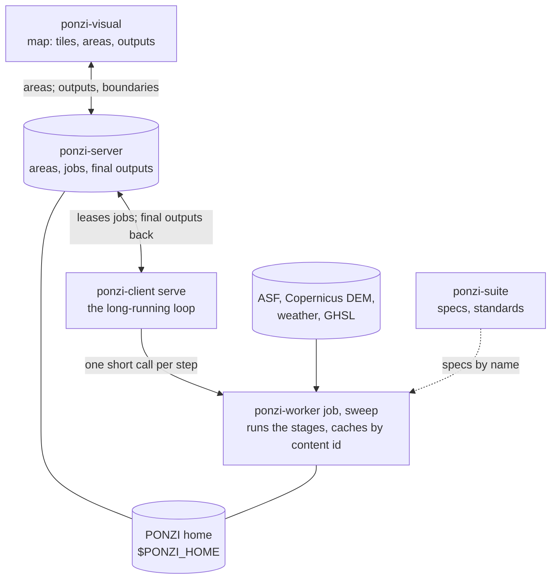
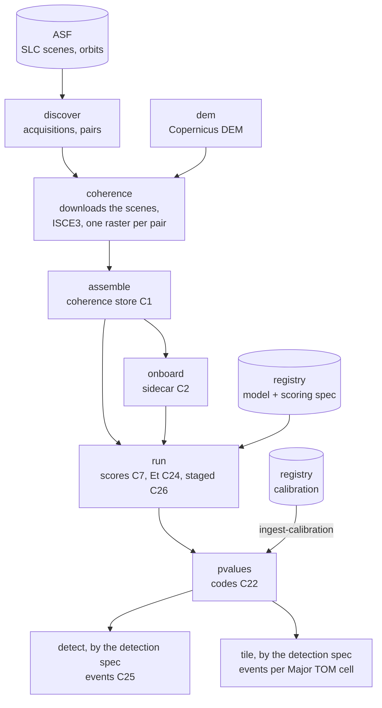
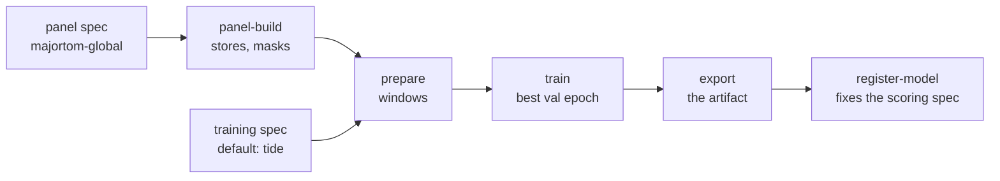
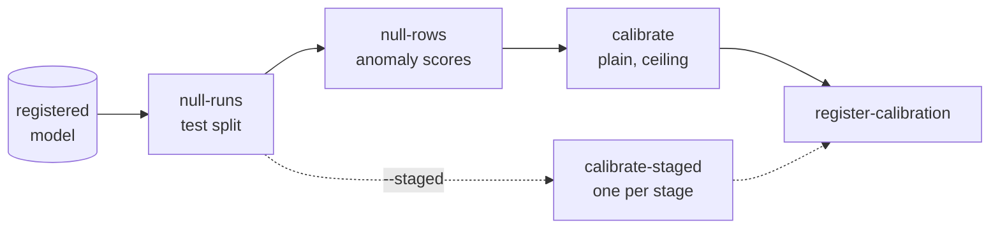
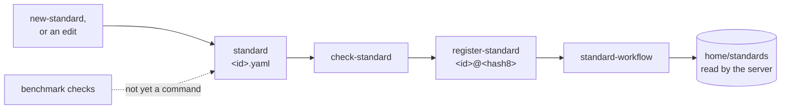

---
hide:
  - toc
---

# How PONZI works

The method, where it runs, how its registered pieces are made, and what a change to one of them makes new. Every diagram follows the code as it stands; the [Glossary](../reference/terminology.md) defines the words.

## The method

<svg viewBox="0 0 640 470" role="img" aria-label="The PONZI method: the context of 30 acquisitions, the block of 25 pairs ending on t to t+4 with the 15-pair pyramid that spans the gap before t, then forecast, score, calibrate and detect">
<defs><marker id="pz-head" viewBox="0 0 10 10" refX="9" refY="5" markerWidth="7" markerHeight="7" orient="auto-start-reverse"><path class="pz-head" d="M0,0 L10,5 L0,10 z"/></marker></defs>
<text class="pz-title" x="20" y="22">The coherence of one pixel: pairs ending on each acquisition</text>
<rect class="pz-ctx" x="66" y="60" width="118" height="150" rx="4"/>
<text x="125" y="120" text-anchor="middle">context</text>
<text class="pz-small" x="125" y="136" text-anchor="middle">30 acquisitions</text>
<text class="pz-small" x="125" y="150" text-anchor="middle">before t</text>
<text class="pz-small" x="58" y="77" text-anchor="end">12 d</text>
<rect class="pz-pyr" x="196" y="60" width="40" height="26" rx="3"/>
<rect class="pz-cell" x="240" y="60" width="40" height="26" rx="3"/>
<rect class="pz-cell" x="284" y="60" width="40" height="26" rx="3"/>
<rect class="pz-cell" x="328" y="60" width="40" height="26" rx="3"/>
<rect class="pz-cell" x="372" y="60" width="40" height="26" rx="3"/>
<text class="pz-small" x="58" y="108" text-anchor="end">24 d</text>
<rect class="pz-pyr" x="196" y="91" width="40" height="26" rx="3"/>
<rect class="pz-pyr" x="240" y="91" width="40" height="26" rx="3"/>
<rect class="pz-cell" x="284" y="91" width="40" height="26" rx="3"/>
<rect class="pz-cell" x="328" y="91" width="40" height="26" rx="3"/>
<rect class="pz-cell" x="372" y="91" width="40" height="26" rx="3"/>
<text class="pz-small" x="58" y="139" text-anchor="end">36 d</text>
<rect class="pz-pyr" x="196" y="122" width="40" height="26" rx="3"/>
<rect class="pz-pyr" x="240" y="122" width="40" height="26" rx="3"/>
<rect class="pz-pyr" x="284" y="122" width="40" height="26" rx="3"/>
<rect class="pz-cell" x="328" y="122" width="40" height="26" rx="3"/>
<rect class="pz-cell" x="372" y="122" width="40" height="26" rx="3"/>
<text class="pz-small" x="58" y="170" text-anchor="end">48 d</text>
<rect class="pz-pyr" x="196" y="153" width="40" height="26" rx="3"/>
<rect class="pz-pyr" x="240" y="153" width="40" height="26" rx="3"/>
<rect class="pz-pyr" x="284" y="153" width="40" height="26" rx="3"/>
<rect class="pz-pyr" x="328" y="153" width="40" height="26" rx="3"/>
<rect class="pz-cell" x="372" y="153" width="40" height="26" rx="3"/>
<text class="pz-small" x="58" y="201" text-anchor="end">60 d</text>
<rect class="pz-pyr" x="196" y="184" width="40" height="26" rx="3"/>
<rect class="pz-pyr" x="240" y="184" width="40" height="26" rx="3"/>
<rect class="pz-pyr" x="284" y="184" width="40" height="26" rx="3"/>
<rect class="pz-pyr" x="328" y="184" width="40" height="26" rx="3"/>
<rect class="pz-pyr" x="372" y="184" width="40" height="26" rx="3"/>
<text class="pz-small" x="216.0" y="52" text-anchor="middle">t</text>
<text class="pz-small" x="260.0" y="52" text-anchor="middle">t+1</text>
<text class="pz-small" x="304.0" y="52" text-anchor="middle">t+2</text>
<text class="pz-small" x="348.0" y="52" text-anchor="middle">t+3</text>
<text class="pz-small" x="392.0" y="52" text-anchor="middle">t+4</text>
<line class="pz-gap" x1="193.0" y1="56" x2="193.0" y2="214"/>
<text class="pz-small" x="426" y="74">block t to t+4:</text>
<text class="pz-small" x="426" y="89">25 pairs, 5 baselines</text>
<text class="pz-small" x="426" y="104">by 5 acquisitions</text>
<text class="pz-small" x="426" y="134">filled: the pyramid,</text>
<text class="pz-small" x="426" y="149">the 15 pairs that span</text>
<text class="pz-small" x="426" y="164">the gap before t</text>
<text class="pz-small" x="426" y="179">(dashed line)</text>
<path class="pz-arrow" d="M304,216 L304,236 L88,236 L88,259"/>
<rect class="pz-box" x="20" y="262" width="136" height="142" rx="6"/>
<text class="pz-title" x="30" y="284">1 Forecast</text>
<text class="pz-small" x="30" y="306">the forecaster (default</text>
<text class="pz-small" x="30" y="323">TiDE, or another) gives</text>
<text class="pz-small" x="30" y="340">quantiles of the 25</text>
<text class="pz-small" x="30" y="357">pairs from the context</text>
<text class="pz-small" x="30" y="374">and the covariates</text>
<text class="pz-small" x="88.0" y="422" text-anchor="middle">uses: model + scoring spec</text>
<rect class="pz-box" x="176" y="262" width="136" height="142" rx="6"/>
<text class="pz-title" x="186" y="284">2 Score</text>
<text class="pz-small" x="186" y="306">z: each observed pair</text>
<text class="pz-small" x="186" y="323">against its forecast;</text>
<text class="pz-small" x="186" y="340">anomaly score: mean z</text>
<text class="pz-small" x="186" y="357">over the pyramid;</text>
<text class="pz-small" x="186" y="374">ceiling score</text>
<text class="pz-small" x="244.0" y="422" text-anchor="middle">uses: score.zarr, Et</text>
<line class="pz-arrow" x1="158" y1="333.0" x2="173" y2="333.0"/>
<rect class="pz-box" x="332" y="262" width="136" height="142" rx="6"/>
<text class="pz-title" x="342" y="284">3 Calibrate</text>
<text class="pz-small" x="342" y="306">p: share of the panel</text>
<text class="pz-small" x="342" y="323">null at or above the</text>
<text class="pz-small" x="342" y="340">score; code =</text>
<text class="pz-small" x="342" y="357">round(20 x -log10 p)</text>
<text class="pz-small" x="342" y="374">(plain or ceiling)</text>
<text class="pz-small" x="400.0" y="422" text-anchor="middle">uses: calibration</text>
<line class="pz-arrow" x1="314" y1="333.0" x2="329" y2="333.0"/>
<rect class="pz-box" x="488" y="262" width="136" height="142" rx="6"/>
<text class="pz-title" x="498" y="284">4 Detect</text>
<text class="pz-small" x="498" y="306">flag: code at or above</text>
<text class="pz-small" x="498" y="323">the threshold (50);</text>
<text class="pz-small" x="498" y="340">runs of flags per</text>
<text class="pz-small" x="498" y="357">path, dated by Et:</text>
<text class="pz-small" x="498" y="374">disturbance events</text>
<text class="pz-small" x="556.0" y="422" text-anchor="middle">uses: detection spec</text>
<line class="pz-arrow" x1="470" y1="333.0" x2="485" y2="333.0"/>
<text class="pz-small" x="20" y="452">In monitoring this repeats at every new acquisition; staged runs score an anchor before its block is complete</text>
<text class="pz-small" x="20" y="466">(stages 1 to 4), and the final stage confirms or withdraws its flags.</text>
</svg>

From the 30 acquisitions before an anchor `t` and the covariates (weather, built-up), the forecaster predicts the coherence of the 25 pairs ending on `t` to `t + 4` (baselines 12 to 60 days). Each observed pair is scored against its forecast (`z`). The 15 pairs that span the gap before `t`, the **pyramid**, are the ones a change at `t` lowers, and their mean `z` is the anomaly score of `t`. The score is turned into a p-value against the same score on the held-out test cells of the panel (the **null**), stored as a code. The detection spec flags codes at or above its threshold, joins flags into runs along a path, and dates each change by the break statistic `Et`: the **surface disturbance events**. Labelled damage (BRIGHT, UNOSAT) is used only to evaluate.

## Where it runs

The server keeps the watched areas, makes one job per burst at each area's cadence, named by the burst's newest acquisition so that a look with nothing new makes no new job (CR-101), and stores the final outputs; it computes nothing. `ponzi-client serve`, the only long-running process, claims jobs and has the worker carry them out in short calls (`ponzi-worker job`; under SLURM, one `ponzi-worker sweep` over every job it holds, CR-096); the worker keeps every output in its cache by content id, so the same work is never done twice, and the client delivers the final outputs, sent straight from the worker's machine when it can reach the server (CR-098). Everything computed lives in the PONZI home; the repositories hold code and the files PONZI runs from ([Running the server](../service/server.md), [Workflows and the cache](../service/worker.md)).

## One burst under a standard

What a job runs: the workflow of the area's [standard](../models/standards.md), for one burst and the area's days.

`tile` is the final step: its `ponzi-events-cell` Items are the ones the server keeps. `detect` still runs, and its per-burst events stay in the worker's cache (CR-100). A standard made from existing stores starts at `ingest-coherence` instead of the first four stages.

## How the registered pieces are made

The model, its calibrations and the standard are made with `ponzi-models`, from the files in ponzi-suite, into the PONZI home. `panel-build` writes the panel's stores and masks to `$PONZI_HOME/panels/`; `prepare` makes the train and validation windows (layer `sample_train`); `export` writes the artifact (TiDE: TorchScript and `meta.json`); `register-model` files it with one scoring spec, whose hash is fixed from then on. The null runs are production runs on the panel's test split (layer `sample_test`); `register-calibration` files each calibration under its model, with the scoring spec hash and the library version it was made with. A standard names its model, calibrations and specs; its key is `<id>@<hash8>` ([Standard versions](../models/versions.md)).

**Training**

**Calibration**

**A standard**

The fixed checks a candidate standard is compared on are not yet a command: `ponzi.evaluation` has the metrics, and `ponzi-models rehearse` runs the whole lifecycle on synthetic data.

## What a change makes new

Each piece is fixed at a known point, and a change to it gives new content ids to everything downstream of it, which the worker then computes; everything upstream is reused from the cache.

Pick a kind of work to see its path through the system. (The map needs JavaScript; the matrix below says the same.)

Pick a kind of work to see where its data comes in, which registered pieces it makes new, which it computes again and which it reuses. Purple dashed pieces should be computed again but are reused as the code stands (an engine change below a major); dotted ones are not yet in the code.

| Piece | Fixed by | A change means |
| --- | --- | --- |
| Library (`ponzi`, `ponzi-pipeline`) | its version, `0.y` the major below 1.0 | a new major gives new content ids to the stages its code computes (CR-054), and a calibration refuses runs of another major (CR-020) |
| Coherence spec, onboarding spec | its name and hash, named by the standard | new coherence stores and sidecars, and everything after |
| Panel spec | its name and hash (`panel.yaml` and its files) | a new hash, so a new model and calibration: the model id carries the panel spec's name and hash |
| Training spec | its name and hash, in `specs/training_specs/` | a new fit, a new model |
| Scoring spec | its hash, fixed at `register-model` | new runs; a calibration is made for one hash and refuses others |
| Calibration | its id under the model, the scoring spec hash | new p-values and events; runs reused |
| Detection spec | its name and hash, named by the standard | new events and cells; runs and p-values reused |
| Standard | `id@hash8`, its content hash (CR-089); immutable once registered | any change but its description is a new version; areas name the version they run |
| Area | its tiles (and so its bursts, of both passes) and its days | its jobs; no new standard |

**The change matrix.** What each kind of work makes new, recomputes or reuses, as the worker behaves today.

| Work | New | Recomputed | Reused | Today |
| --- | --- | --- | --- | --- |
| A. New area | the area | the stages of bursts not yet computed | the registry; any burst already computed | as intended |
| B. Monitoring update | the pairs Item (identified by the acquisitions found) | the new pairs' coherence; then the store, sidecar, a new staged run over the window, p-values, events | the earlier pairs; a day with nothing new reuses everything | a monitoring update is a new run, never an appended one |
| C. Fine-tune for an area | a child model (`init_from`), its calibration, a standard of its own | runs, p-values, events | coherence stores, sidecars | the two standards are not linked in the code |
| D. New panel spec or training spec | model, calibration, a new standard version (a `run` change) | runs onward | coherence stores of bursts in both | as intended |
| E. Better calibration | calibration, a new standard version (a `products` change) | p-values, events | runs | nothing checks that its cells stayed out of training |
| F. New detection spec | a new standard version (a `products` change) | events, cells | runs, p-values | as intended |
| G. Library major change | the release, a rebuilt calibration | the stages whose `code` names the library: for `ponzi`, the store assembly, runs, p-values, events and cells; for `ponzi-pipeline`, coherence onward | the stages of other code | as intended (CR-054) |
| H. Coherence engine change | new stores when the coherence spec changes, or with a new `ponzi-pipeline` major | stores onward | | **not automatic** for a minor or patch release of `ponzi-pipeline` or a new ISCE3 with the same coherence spec: stores are reused |

What a standard's new version means for runs, and how `check-standard` and `register-standard` report it: [Standard versions](../models/versions.md#what-a-change-means).
